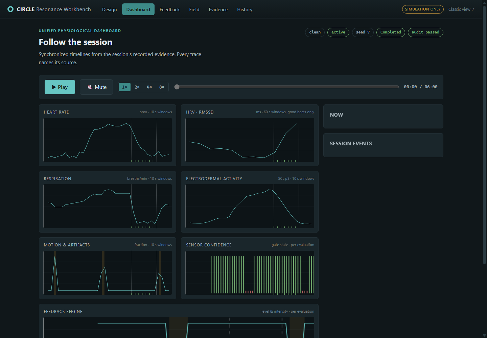
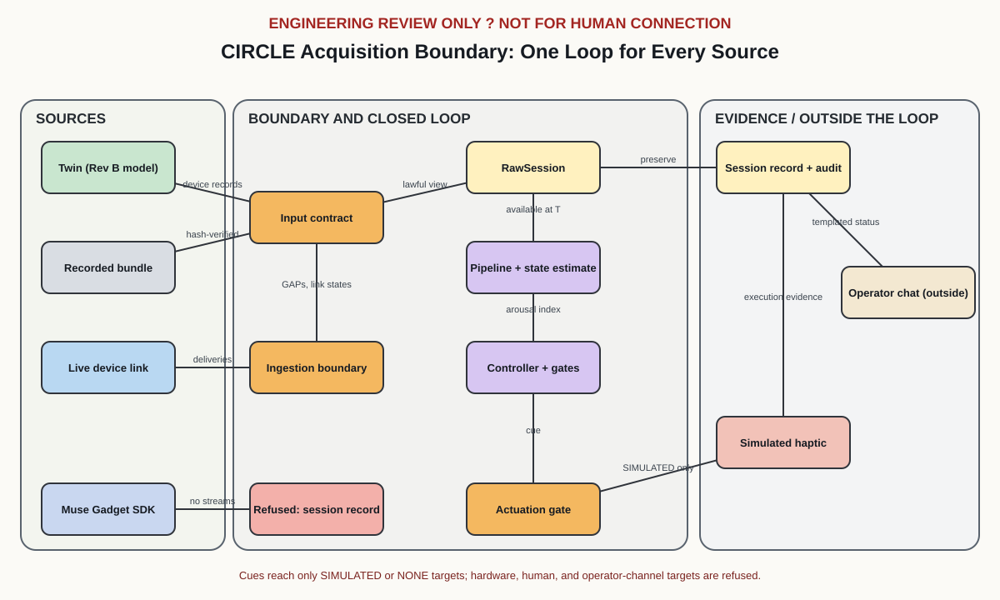
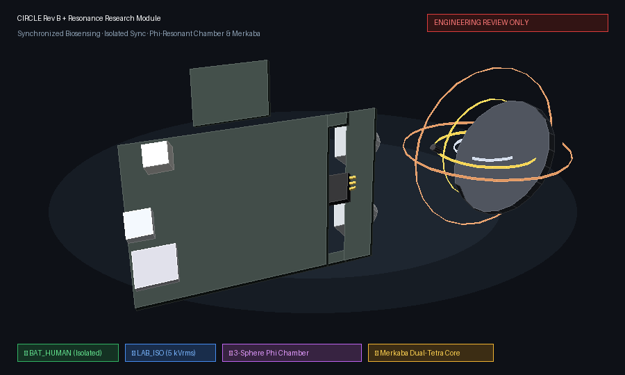

# CIRCLE

<div align="center">

<sub>VERS3DYNAMICS &nbsp;/&nbsp; RESONANCE WORKBENCH</sub>

<h2>A human state is never one signal.</h2>

<p><strong>From signals to sound. From decisions to evidence.</strong></p>

<p>
Explore how simulated physiological rhythms become adaptive audio, responsive visuals,<br />
and decisions you can trace all the way back to their source.
</p>

<p>
<a href="https://topherchris420.github.io/circle/"><strong>Experience the demo</strong></a>
&nbsp; · &nbsp;
<a href="#quick-start"><strong>Run locally</strong></a>
&nbsp; · &nbsp;
<a href="#how-circle-works">Explore the science</a>
&nbsp; · &nbsp;
<a href="#first-light-a-physical-sensor-end-to-end">First Light: a real sensor</a>
</p>

<p><sub>OPEN SOURCE &nbsp; · &nbsp; SIMULATION-BASED, WITH ONE REAL-SENSOR DEMONSTRATION &nbsp; · &nbsp; NOT A MEDICAL DEVICE</sub></p>



<p><sub>Actual Resonance Workbench capture. A recorded six-minute simulation, not live human measurements.</sub></p>

<p>
<a href="https://github.com/topherchris420/circle/actions"></a>
&nbsp;
<a href="#quick-start"></a>
&nbsp;
<a href="LICENSE"></a>
</p>

</div>

---

**Built to make feedback accountable.**

CIRCLE's ambition is an instrument that can explain what it observed, account for what it changed, and preserve the person's authority over what happens next.

### One platform. Different ways to explore.

- **Researchers:** Design experiments, compare active and sham conditions, and challenge the evidence through independent software replay.
- **Engineers:** Investigate signal quality, controller decisions, and deliberate failure handling before attempting physical-device integration.
- **Creative technologists:** Explore how recorded physiological rhythms become adaptive sound and responsive visuals, with every mapping inspectable.
- **Curious visitors:** Experience the simulation workbench, or explore real phone-camera recordings and quality-gated feedback decisions.

**Explore [First Light](https://topherchris420.github.io/circle/first-light.html):** Real smartphone-camera recordings are evaluated against ECG references, with each decision independently reconstructable. The live phone-camera path remains experimental and has not yet been physically tested by the authors.

**What would make a system that responds to the body worthy of trust?**

CIRCLE makes that question testable. Start with simulated sensor records, follow quality-gated decisions into bounded adaptive feedback, and inspect the evidence behind each response or refusal. Replay a session, compare active and sham conditions, or independently reconstruct its results from the exported record.

The Resonance Workbench is a public, self-guided introduction to the research. The underlying platform also includes an offline test bench, portable evidence verification, experimental device adapters, and a bounded R.A.I.N. proposal interface. These are research tools, not validated physiological measurements or evidence of a therapeutic effect.

> [!WARNING]
> **ENGINEERING REVIEW ONLY.** Experimental research hardware and software. This repository is not approved for fabrication or human connection and does not establish medical-device, electrical-safety, EMC, or measurement-performance claims. All physiological results shown here come from simulation, except [First Light](#first-light-a-physical-sensor-end-to-end), which is tested on public recordings from real phone cameras.

## Quick start

**Nothing to install:** [open the offline demo](https://topherchris420.github.io/circle/workbench.html). It replays a prerecorded simulated session in your browser, with playback, adaptive audio, and the evidence behind every decision. Nothing is sent anywhere. The [research site](https://topherchris420.github.io/circle/) and its [workbench](https://topherchris420.github.io/circle/workbench.html) are built into [`demo/`](demo) from [`site/`](site) by [`tools/build_demo.py`](tools/build_demo.py), and the same scenario and seed reproduce them locally.

### Run it locally

You need **Python 3.11+** and Git. No device, account, API key, or model server is required.

```bash
git clone https://github.com/topherchris420/circle.git
cd circle
python -m pip install -r requirements.txt
python tools/run_workbench.py
```

<details>
<summary>Prefer an isolated Python environment?</summary>

After cloning and entering `circle`, create a virtual environment with `python -m venv .venv`. Activate it with `source .venv/bin/activate` on macOS/Linux or `.\.venv\Scripts\Activate.ps1` in Windows PowerShell, then run the install and launch commands above. If your system names Python `python3`, use that command instead.

</details>

The browser opens the guided workbench at **http://127.0.0.1:8765**. The **Resonance Workbench** pictured above is at **http://127.0.0.1:8765/resonance**, also linked from the guided view's sidebar. Keep the terminal running; you can close and reopen the browser tab without losing the session. Start with **A clear signal**, then try **A loose
sensor** to explore why measurement quality and evidence integrity are separate
results. All feedback is simulated.

The **Resonance Workbench** is the research interface: a synchronized physiological
dashboard, an original consent-gated adaptive audio engine, a responsive visual
feedback field, a guided session designer, and an evidence explorer that follows
any feedback decision back to its measurements. Choose one of eight guided
scenarios, run an active or sham session, and see the measurement checks alongside
an independent audit. Your session history, interactive reports, and downloadable
evidence stay on your computer.

The dashboard's sibling views: the [session designer](diagrams/resonance-workbench-designer.png) with its
consent-gated feedback settings, the [feedback studio](diagrams/resonance-workbench-studio.png) showing the
live parameter mapping, the [visual field](diagrams/resonance-workbench-visual.png), and the
[evidence explorer](diagrams/resonance-workbench-evidence.png). The
[Resonance Workbench guide](docs/resonance-workbench.md) explains the architecture, the mapping table,
benchmarks, and boundaries. 

[Workbench guide, downloads, and troubleshooting](docs/workbench.md) ·
Use `--port 8766` if the default port is busy, or `--no-browser` to open it manually.

### Run your first session from the command line

Everything the workbench does is also a script. From the `circle` directory:

```bash
python tools/run_physiology_twin.py --output outputs/physiology --audit
```

The default run simulates **six minutes**: rest, breath hold, a stressor, and recovery with adaptive haptic guidance. It also runs a matched sham arm for comparison, exports the session, scores estimates against hidden truth, and audits the exported evidence.

### Open the report and follow one decision

Open **`outputs/physiology/report.html`** in your browser. The report is self-contained: zoom the traces, open a row in the decision ledger, and follow its evidence down to the source samples.

| Question | Where to look |
| --- | --- |
| What did the controller know at that moment? | Input cutoff, availability times, features, and exact sample ranges |
| Why did it act—or hold? | Controller state, formula components, and quality-gate outcomes |
| Did the cue occur? | Command, electrical onset, and IMU-observed vibration |
| What changes when cues are withheld? | Matched sham traces, under the twin's assumed response model |
| Can the record be reconstructed? | Decision replay and independent audit verdict |

A successful reconstruction reports **`REPLAY_MATCH`**. That establishes agreement between the export and reconstruction from its inputs. The simulation scorecard separately measures agreement with the twin's truth.

To explore before running anything, open the [committed example report](diagrams/circle-physiology-session.html) locally after cloning.

### Know what the run preserves

| Export | Purpose |
| --- | --- |
| `raw/*.csv.gz` | Sensor codes and timing records used for reconstruction |
| `session.ndjson` | Versioned device and derived records, lineage, gaps, and intervention chains |
| `closed_loop_ledger.json` | Every controller evaluation and the evidence it read |
| `analysis.json` · `scorecard.json` | Recovered estimates and checks against simulated truth |
| `truth.json` · `counterfactual.json` | Evaluator truth and the matched opposite arm; never controller inputs |
| `manifest.json` · `passport.txt` | Configuration, software provenance, artifact hashes, and session summary |
| `report.html` | Interactive view of the traces, decisions, scorecard, and execution evidence |

The [pipeline methods](docs/physiology-pipeline.md) explain how each channel and metric is derived.

### Reproduce what you see

- **The film** (90 seconds): [`marketing/circle-film-90s.mp4`](marketing/circle-film-90s.mp4)
  replays one simulated session, a sensor loss injected on purpose, the recorded
  R.A.I.N. run, and a verification. Every frame of data is labeled simulation;
  [how it was made](marketing/README.md) lists the source of each claim.
- **One-command independent replication**: every downloaded evidence bundle ships
  `verify_replication.py`. On any machine with Python 3.11+:
  `python verify_replication.py <directory>` recomputes every hash, rebuilds the
  analysis and every decision from the raw samples, and names the verdict —
  `REPLAY_MATCH`, `REPLAY_DIVERGENCE`, `INTEGRITY_FAILURE`, or
  `INSUFFICIENT_EVIDENCE`. A matching replay shows the package reproduces from
  its inputs; it does not show it measured the world.
- **Bring your own instrument**: a documented adapter SDK maps
  [BrainFlow](docs/hardware-agnostic-acquisition.md) boards and Lab Streaming
  Layer outlets onto CIRCLE's stream contract; sources lacking EDA/PPG/IMU are
  refused with recorded reasons, never silently accepted.
- **Cryptographic consent**: audio feedback is a restricted mutation through the
  Ed25519 consent gate ([`models/consent_gate.py`](models/consent_gate.py)) —
  proposed, signed, revocable, and hash-linked in a durable log a workbench
  restart cannot quietly execute.

## First Light: a physical sensor, end to end

**[Open First Light](https://topherchris420.github.io/circle/first-light.html)** on a phone or a laptop. It runs one chain on a real sensor and keeps the evidence for every link:

**real measurement → quality assessment → adaptive response → deliberate sensor failure → safe refusal → independently verified evidence**

A phone camera measures the pulse through a fingertip. Six quality gates judge the last 8 seconds. When they all pass, the pulse is reported and a bounded sound follows it. When the sensor is disturbed on purpose, the system must withhold the pulse, fall silent, and record why. A second program, sharing no code with the first, then rebuilds every decision from the raw frames.

The page offers three sources: a real recording that needs no camera, your own phone camera, and a known-input optical phantom.

### Tested on recordings it had not seen

The test used 56 continuous smartphone-camera recordings from 8 people in the public [BUT PPG](https://physionet.org/content/butppg/2.0.0/) dataset (CC BY 4.0), with chest ECG recorded at the same time. Thresholds were calibrated on other people. The criteria were [committed before the test ran](evidence/first-light/round-2/PREREGISTRATION.md), and it ran once.

| Criterion | Bar | Measured |
| --- | --- | --- |
| Reported pulse within ±5 bpm of ECG over the same 8 seconds | ≥ 0.90 | **0.990** (575 of 581) |
| Windows that experts labelled unusable were refused | ≥ 0.95 | **0.994** (4,106 of 4,132) |
| Windows that experts labelled usable were acted on | ≥ 0.15 | **0.340** (490 of 1,440) |
| Audible commands issued with a refusal | 0 | **0** |

Both implementations agreed on all **7,196** decisions, and every session was rebuilt byte for byte from the public archive.

**An earlier round failed.** It required action on 50% of usable windows, a bar set without data, and measured 5.8%. [That result is kept](evidence/first-light/round-1/README.md). The system is cautious by design: two of the eight people account for 478 of the 490 actions, and for two people it never acted.

### Check it yourself

The verifier is one file and needs only Python 3.11 or later:

```bash
python tools/verify_first_light.py evidence/first-light/sessions/149055-072.zip
```

It names four results: integrity, replay, protocol, and source. [The method](docs/first-light.md) gives the full algorithm, the bundle format, the criteria, and the command that reruns the whole test from the public data.

**What this does not show.** The live camera path has been exercised with a simulated camera only; no one has yet contributed a session from a physical phone, and [yours would be the first](docs/first-light.md#add-a-recording). The recordings come from two phone models. A camera pulse rate is not a medical measurement. No effect of the sound on any person is tested. A phone camera is not CIRCLE hardware.

## How CIRCLE works

The central question is **what gives this system grounds to act?**

A rise in heart rate is one observation. A rise in skin conductance is another. CIRCLE requires agreement across the cardiovascular and electrodermal pathways, sufficient signal quality, and a sustained observed state before guidance can begin.

| Stage | Evidence CIRCLE preserves |
| --- | --- |
| **Observe** | Raw skin conductance (EDA), optical pulse (PPG), motion (IMU), and synchronization records; device times, sequence numbers, availability, and declared gaps |
| **Infer** | Recovered physiological features, with lineage to the exact samples used |
| **Decide** | State, input cutoff, formula components, and explicit outcomes for acting, holding, or stopping |
| **Intervene** | The scheduled command, electrical onset, and vibration detected from IMU samples |
| **Reconstruct** | Analysis and derived records rebuilt from raw inputs, followed by an explicit replay verdict |



Three rules make the loop inspectable:

- **A decision can use only evidence available at the time.** A sample must have been available by the decision time and been taken at or before the input cutoff. FIFO stalls, delayed delivery, and missing samples remain visible in the record.
- **Holding is a decision.** Motion, poor contact, stale data, or disagreeing pathways can prevent guidance. After impairment, the controller requires a full clean **40-second evidence window** before treating an elevated state as sustained; repeated quality loss during guidance stops it.
- **Each stage earns its own evidence.** A command does not prove vibration, and vibration does not establish a physiological effect. `PHYSICALLY_OBSERVED` requires an observation record; in this test bench, that observation is simulated too.

The pipeline and controller consume the shared [`RawSession` boundary](models/physiology/loop.py) without importing hidden truth. The auditor reconstructs derived records instead of accepting their stored values. A derived record that disagrees with reconstruction remains detectable even if its checksums are rewritten; hashes alone do not authenticate the underlying data.

Replay names its result: `REPLAY_MATCH`, `REPLAY_DIVERGENCE`, `TIMING_VIOLATION`, `VERSION_MISMATCH`, `EVIDENCE_INTEGRITY_FAILURE`, `MISSING_SOURCE`, or `INSUFFICIENT_EVIDENCE`.

Read the [evidence contract and failure history](docs/closed-loop-evidence.md), [record schema](contracts/session-record.schema.json), and [auditor](models/physiology/audit.py).

## Test the failure modes

Change the conditions, then inspect whether the controller's behavior is justified:

```bash
# Same seed, sham arm: decisions recorded, cues withheld
python tools/run_physiology_twin.py --sham --no-counterfactual --output outputs/sham --audit

# Eight scenario families, including motion, contact loss, and timing faults
python tools/run_physiology_twin.py --scenarios --output outputs/scenarios

# Audit an existing export without rerunning the twin
python tools/audit_physiology_run.py outputs/physiology
```

The scenario suite tests both sides of the decision: refusing unwarranted guidance **and** acting when a warranted state becomes observable. A controller that always holds cannot pass. The [scenario definitions](models/physiology/scenarios.py) specify each disturbance and judge the result against hidden truth.

To inspect a deliberate loss of measurement quality, export the poor-contact scenario:

```bash
python tools/run_physiology_twin.py --scenario poor_contact --output outputs/poor-contact --audit
```

With the default seed 7, this run withholds guidance, passes **14 of 19 scorecard checks**, and returns exit code **1** because five checks fail. Its audit still reports **`REPLAY_MATCH`**: the impaired session can be reconstructed faithfully. Measurement quality and evidence integrity answer different questions. Open `outputs/poor-contact/report.html` to examine both.

The twin assumes that paced breathing changes its simulated physiology. Active-versus-sham comparisons test the software under that assumption; a physiological effect in people would need separate evidence.

## Results you can inspect

The checked-in physiology benchmark covers **50 seeds, 100–149**. Its numbers describe agreement with **simulated truth**, under the stated scoring conditions.

| Measurement | Recorded result | Evaluation condition |
| --- | --- | --- |
| Heartbeat detection | Mean F1 **0.9999** | Motion-free PPG; ±50 ms matching tolerance |
| Heart rate | Mean absolute error **0.39 bpm** | Recovered from raw sensor codes |
| HRV: RMSSD | Mean absolute error **1.5 ms** | 60-second windows |
| Respiratory rate | Mean absolute error **0.36 breaths/min** | Recovered respiratory modulation |
| Skin conductance response detection | Mean sensitivity **0.98**, positive predictive value **1.00** | Motion-free responses ≥0.05 µS |
| PPG FIFO timing | Worst error **39.18 µs** | Reconstructed sample timestamps |
| Haptic onset detection | Worst error **2.97 ms** | IMU detection versus the twin's onset |

**999 of 1,000 checks passed.** Seed 147 failed the skin-conductance response sensitivity threshold: **11 of 14 responses detected**, below the required 0.85 sensitivity. The [benchmark](docs/physiology-benchmark.json) retains the failure; the [methods](docs/physiology-pipeline.md) explain the overlapping responses and resolution limits.

**Controller 1.2.0 passed 240 of 240 runs** across eight scenario families on fresh confirmatory seeds **600–629**. The [scenario benchmark](docs/scenario-benchmark.json) records the conditions. An earlier controller passed 199 of 210 runs; its failures exposed guidance starting from an elevated state that had already resolved during a motion-obscured interval. That finding produced the clean-window precondition and evaluation on new seeds. The [evidence history](docs/closed-loop-evidence.md) preserves both rounds.

These results establish software behavior under the twin's models. Sensor accuracy, assembled-hardware performance, and human outcomes each need their own measurements.

## Human authority in the loop

CIRCLE's consent work asks a second question: **who has authority to turn a proposal into a change?** Two mechanisms address different parts of that boundary.

### Consent-by-Design

[`circle_authority.py`](circle_authority.py) implements a standalone deterministic consent gate. A restricted proposal becomes an immutable envelope containing its mutation, proposal timestamp, state-history hash, action UUID, and an initially empty signature slot. It waits as data while the loop continues processing telemetry.

| Action state | What happens |
| --- | --- |
| `PENDING_SIGNATURE` | The proposal is registered; telemetry continues; the mutation waits. |
| `EXECUTED` | Matching consent verifies against the registered Ed25519 human public key and the mutation completes; signature and execution frame are recorded. |
| `REJECTED` | Proposal, consent, or execution checks fail; no automatic retry follows. |

```bash
python tools/run_authority_demo.py
```

The demo receives a proposal at frame 1, continues telemetry through frames 2 and 3, and executes the signed mutation at frame 4. Repeated runs produce identical replay records using fixed **test-only** credentials.

**The gate is standalone; the physiological controller and protocol runner do not yet route through it.** Its signature authenticates the UUID. Durable bindings between UUIDs and envelopes, protected replay storage, and execution-time state checks are host responsibilities. The [consent integration contract](docs/consent-by-design.md) specifies these boundaries and failure behavior.

### Authorize a bounded experiment

The [protocol runner](models/protocols.py) validates proposed experiments against deterministic rules: simulation-only targets, mandatory sham arms, preserved timing margins, held-out seed checks, and corrected statistical comparisons. A named reviewer record binds authorization to the protocol's SHA-256. This record is separate from the Ed25519 consent mechanism.

<details>
<summary>Validate, authorize, and run the example protocol</summary>

```bash
python tools/run_protocol.py validate experiments/protocols/paced-breathing-arousal.json
python tools/run_protocol.py authorize experiments/protocols/paced-breathing-arousal.json --reviewer "Your Name" --output outputs/auth.json
python tools/run_protocol.py run experiments/protocols/paced-breathing-arousal.json --authorization outputs/auth.json --output outputs/protocol-result.json
```

Run the quick start first so `outputs/` exists. Review the protocol before recording authorization in your name. See the [protocol evidence contract](docs/closed-loop-evidence.md#ai-may-propose-circle-executes-the-contract) for validation and interpretation boundaries.

</details>

AI can help formulate and examine a proposal. The deterministic checks and human authorization define what may proceed.

## What you can examine

The [capability registry](capabilities.json) records implemented code, evidence, and limits. Use it to distinguish a runnable module from a design or research hypothesis.

| Area | Available now | Current boundary |
| --- | --- | --- |
| [Resonance Workbench](docs/resonance-workbench.md) | Synchronized physiological dashboard with playback, consent-gated adaptive audio, visual feedback field, session designer, evidence explorer, and deterministic timeline API | Simulation playback, not live measurement; no audio or visual effect on people is claimed |
| [Adaptive feedback mapping](docs/resonance-workbench.md) | Quality-gated, bounded parameter events versioned and replayable from evidence | Presentation layer over recorded evidence; no frequency-effect claim |
| [First Light](docs/first-light.md) | Phone-camera pulse, six quality gates, bounded sound commands, guided sensor fault, evidence bundle, and an independent verifier; tested on 56 held-out public recordings against ECG | Live path not yet run on a physical device by the authors; two phone models; coverage varies by person |
| [Local workbench](docs/workbench.md) | Guided scenarios, active/sham controls, progress, cancellation, history, report viewing, and evidence downloads | Local simulation interface; no live hardware or hosted accounts |
| [Physiology pipeline](docs/physiology-pipeline.md) | Sensor reconstruction, controller, interactive report, export, and audit | Exercised against the twin |
| [Consent gate](docs/consent-by-design.md) | Ed25519 verification, immutable action envelopes, and hash-linked replay | Standalone simulation; integration remains open |
| [Acquisition](docs/hardware-sources.md) | Ingestion, clock mapping, declared gaps, simulated link faults, and recorded replay | No live biosignal device connected here |
| [OpenBCI Cyton](docs/openbci-cyton.md) | 8/16-channel ADS1299 bridge, register read-back, and an internal-signal electronic phantom | Exercised against a simulated board |
| [Oura ring](docs/hardware-sources.md#oura-ring-over-bluetooth-le-experimental-live-bridge) | Experimental BLE acquisition bridge | Exercised against a fake ring |
| [Muse Gadget](docs/hardware-sources.md) | Capability discovery, recorded refusals, protocol validation, optional operator notifications | Supplies no physiological streams; no paired-gadget validation |
| [Rev B hardware](docs/architecture.md) | Schematics, board outlines, design manifest, and engineering review gates | Designed, not built; main and optical boards unrouted |
| [Firmware](docs/timing-and-data-model.md) | Timing behavior modeled by the twin; pin map and initialization specification | Implementation remains open |

### Exercise the acquisition boundary

```bash
python tools/run_acquisition_demo.py
python tools/openbci_cyton.py self-test
python tools/muse_gadget.py capabilities --simulate
```

These examples need no hardware. **The Cyton phantom is a practical route toward physical evidence:** its ADS1299 internal test signal can supply known input through the acquisition chain without a person. The [Cyton guide](docs/openbci-cyton.md) explains the simulated scorecard and optional real-board procedure.

Every source faces the same stream contract. The Cyton provides biopotentials rather than the EDA, PPG, and other streams the physiology controller requires, so the closed loop refuses it and records why. Accepted closed-loop actuator targets are currently **`SIMULATED`** and **`NONE`**.

### From simulation to an instrument

Rev B is designed to make acquisition timing and intervention evidence observable. The **85 × 55 mm main board** combines an ESP32-S3, ADS1220 EDA front end, ICM-42688-P IMU, SDMMC storage, and DRV2605L haptics with current-edge detection. A **25 × 18 mm optical board** carries a MAX30102 red/IR sensor. Isolation, interlocks, and current limiting are design provisions awaiting independent review and measurement.

<div align="center">



<sub>Intended geometry only. Designed, not built.</sub>

</div>

[Main schematic](hardware/reports/pdf/circle-main.pdf) · [Optical schematic](hardware/reports/pdf/circle-ppg.pdf) · [Safety analysis](docs/safety-analysis.md) · [Bring-up plan](docs/board-bringup-and-validation-plan.md) · [3D viewer](diagrams/circle-3d-viewer.html)

The [checked-in verification summary](hardware/reports/verification-summary.json) records passing software scopes and **incomplete full verification** because fresh hardware checks were not run. Archived KiCad 10.0.5 schematic reports pass; PCB reports retain an open allowlist of **52 unrouted nets**. The [18 open review gates](hardware/review-gates.json) do not authorize fabrication or human use.

The next physical milestones are known-input phantoms, bench fixtures, isolation testing, and actuator loopback. The [physical evidence ladder](docs/physical-evidence-ladder.md) defines what each stage must establish before later work can proceed.

### Research extensions

The core instrument can stand independently of the research questions attached to it. The [module registry check](tools/check_module_registry.py) enforces that boundary.

| Extension | Research question or method | Evidence boundary |
| --- | --- | --- |
| [Resonance](docs/resonance-architecture.md) | Coupled-cavity models, blinded comparisons, and [falsifiable geometry hypotheses](docs/resonance-hypotheses.md) | Experimental simulation; no chamber or measured geometry effect |
| [Emergence](docs/emergence-architecture.md) | ATOM correlation search against circular-shift surrogate nulls, with family-wise correction | Exploratory associations; no causal or consciousness claim |
| [PNT](docs/quantum-pnt-architecture.md) | Translation-only 15-state estimator versus an unaided baseline on shared simulated IMU data | Simulation benchmark; quantum sensing remains speculative |
| [R.A.I.N. protocol](docs/rain-circle-experiment-protocol.md) | Versioned experiment manifest, result, and analysis contracts | Contracts here; executor elsewhere |
| [Mathematics intake](docs/MATH_RESEARCH.md) | Proposed packet-loss and clock-drift comparison with a negative control | Research design; implementation and testing remain open |

Each hypothesis needs a predefined comparison, appropriate controls, and a result that could count against it.

## Verify your scope

```bash
# Software, simulation, and deterministic artifact checks
python tools/verify_release.py --software-only

# Full package verification, requiring the pinned KiCad 10.0.5 toolchain
python tools/verify_release.py

# Inspect current review gates and derived authorization boundaries
python tools/check_review_gates.py
```

For the unit and property suite alone, run `python -m unittest discover -s tests`.

Software-only verification reports `SOFTWARE_VERIFIED` when its checks pass. Full verification requires fresh KiCad checks and reports `INCOMPLETE` if the pinned toolchain is unavailable. Neither result closes physical validation or human-use gates. See [verification scopes](docs/verification-scopes.md) and [`toolchain.json`](toolchain.json).

## Documentation

| If you want to… | Start here |
| --- | --- |
| See the chain on a real sensor | [First Light](docs/first-light.md) · [evidence](evidence/first-light/README.md) |
| Understand the measurement methods | [Physiology pipeline](docs/physiology-pipeline.md) |
| Examine timing, replay, and controller failures | [Closed-loop evidence](docs/closed-loop-evidence.md) |
| Integrate the consent reducer | [Consent-by-Design](docs/consent-by-design.md) |
| Add or evaluate an acquisition source | [Hardware sources](docs/hardware-sources.md) · [OpenBCI Cyton](docs/openbci-cyton.md) |
| Review the hardware design | [Architecture](docs/architecture.md) · [Safety analysis](docs/safety-analysis.md) |
| Plan physical validation | [Physical evidence ladder](docs/physical-evidence-ladder.md) · [Bring-up plan](docs/board-bringup-and-validation-plan.md) |
| Interpret verification status | [Verification scopes](docs/verification-scopes.md) · [Capability registry](capabilities.json) |

<details>
<summary>Repository map</summary>

| Path | Purpose |
| --- | --- |
| [`models/physiology/`](models/physiology) | Twin, sensors, pipeline, controller, report, evidence export, and audit |
| [`circle_authority.py`](circle_authority.py) | Consent state machine and replay payloads |
| [`models/acquisition/`](models/acquisition) | Ingestion, clock mapping, link faults, and recorded replay |
| [`models/openbci_cyton/`](models/openbci_cyton) | Cyton bridge, phantom analysis, and simulated board |
| [`models/protocols.py`](models/protocols.py) | Protocol validation, reviewer authorization, and simulation execution |
| [`models/session_records.py`](models/session_records.py) · [`contracts/`](contracts) | Record validation, provenance, lineage, and schemas |
| [`tools/`](tools) · [`tests/`](tests) | Experiments, auditors, verification tools, and regression checks |
| [`experiments/`](experiments) | Protocols and research configurations |
| [`site/`](site) · [`evidence/first-light/`](evidence/first-light) | Research site and First Light pages; First Light's recordings, rounds, and results |
| [`hardware/`](hardware) | KiCad sources, interfaces, manifest, review gates, and reports |
| [`docs/`](docs) · [`diagrams/`](diagrams) | Methods, evidence boundaries, architecture, and visual explanations |

</details>

## Contributing

Useful contributions make a concrete question answerable:

- **Improve an estimator.** Compare it on fresh seeds and retain the cases where it fails.
- **Connect consent to an application path.** Define the restricted mutations, preserve durable UUID bindings, and demonstrate replay and crash-recovery behavior.
- **Strengthen acquisition.** Meet the stream and timing contracts, then exercise loss, delay, refusals, and replay. A Cyton owner can contribute an internal-signal phantom session without collecting personal biosignals.
- **Advance hardware or firmware.** Work through the review gates, timestamping requirements, and known-input validation plans.
- **Challenge a research hypothesis.** Define the comparison and a failure condition before running it; preserve the null result.

[CONTRIBUTING.md](CONTRIBUTING.md) covers setup, the checks CI runs, and the house rules for evidence. [Open an issue](https://github.com/topherchris420/circle/issues/new/choose) with the question, proposed change, evidence it would produce, and a condition that would count as failure. Include the seed and replay verdict when reporting a simulation issue. [GitHub Actions](https://github.com/topherchris420/circle/actions) records current CI results.

## FAQ

<details>
<summary><strong>Can CIRCLE tell what someone is feeling?</strong></summary>

An arousal index is an engineering trigger. Physiological signals alone cannot establish a person's emotion, intent, diagnosis, or consciousness. The current twin is phenomenological and is not fitted to any person.

</details>

<details>
<summary><strong>Does consent gate every physiological cue?</strong></summary>

The Ed25519 authority module is implemented and tested independently. Wiring it into the physiological controller and protocol runner remains an open integration task.

</details>

<details>
<summary><strong>What does a passing audit establish?</strong></summary>

It establishes that the exported session satisfies the checked contracts and agrees with independent reconstruction from its raw inputs. It does not establish that those inputs accurately describe the physical world or that an intervention caused a change.

</details>

<details>
<summary><strong>Can I fabricate Rev B or connect it to a person?</strong></summary>

The boards are designed but unrouted. Fabrication and human connection remain unauthorized under the [open engineering review gates](hardware/review-gates.json). No bench, electrical-safety, EMC, or human-outcome validation of CIRCLE hardware has been performed. [First Light](docs/first-light.md) uses a phone camera and public recordings; it validates no CIRCLE board.

</details>

## Cite CIRCLE

If CIRCLE informs your research, please cite it. GitHub's **Cite this repository** button reads [`CITATION.cff`](CITATION.cff) and produces APA and BibTeX entries.

## License

[MIT](LICENSE). The license grants no approval to fabricate the hardware or connect it to a person; the engineering review boundaries above still apply.

## The premise

A human state is rarely one signal. The body offers many imperfect observations; understanding begins in the relationships among them.

CIRCLE's ambition is an instrument that can explain what it observed, account for what it changed, and preserve the person's authority over what happens next. Every experiment brings that ambition back to a record someone else can examine.

<div align="center">

**A Vers3Dynamics research project by Christopher Woodyard.**<br />
Built by one researcher. Held in common. Free to explore.

</div>
