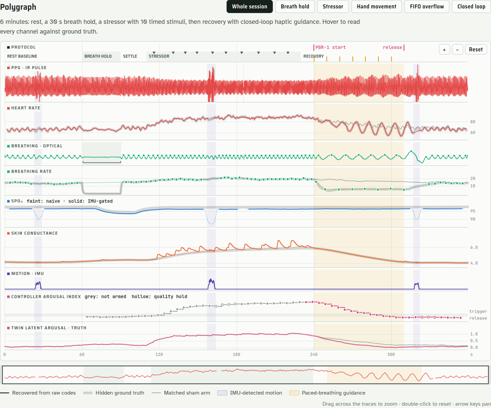
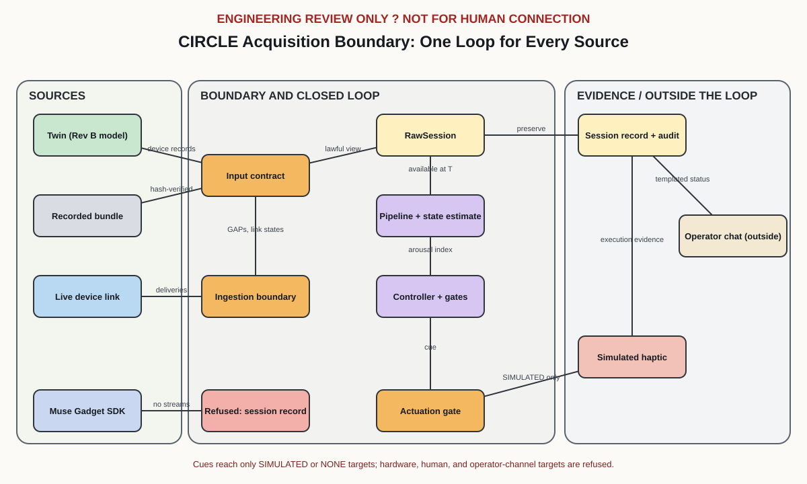
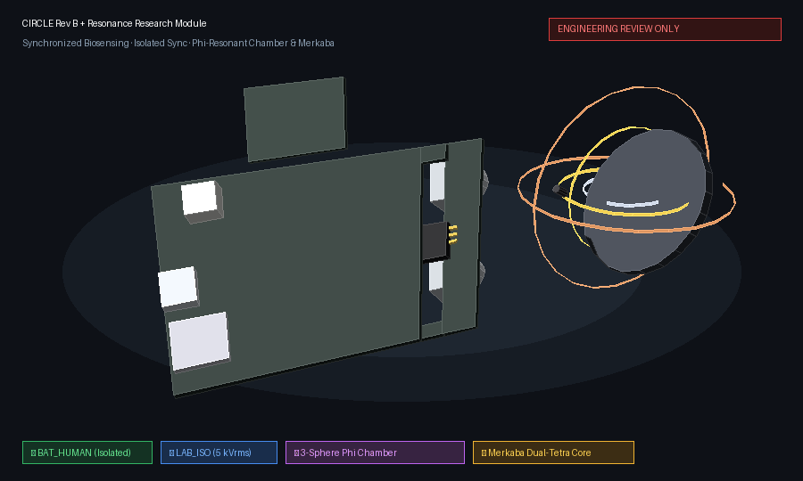

<div align="center">

# CIRCLE

### An open research instrument for physiological signals, adaptive feedback, and human authority.

**A loop that can answer for itself.**

[](https://github.com/topherchris420/circle/actions)
[](#quick-start)
[](#results-you-can-inspect)
[](#from-simulation-to-an-instrument)
[](capabilities.json)
[](LICENSE)

[Quick start](#quick-start) · [How CIRCLE works](#how-circle-works) · [Human authority](#human-authority-in-the-loop) · [Results](#results-you-can-inspect) · [What you can examine](#what-you-can-examine) · [FAQ](#faq) · [Documentation](#documentation)

<code>python tools/run_physiology_twin.py --output outputs/physiology --audit</code>

<br /><br />



<sub>One simulated session, several physiological pathways, a shared timeline. Ground truth is available to the evaluator; the controller must work from the device records it actually receives.</sub>

<br />

</div>

---

A signal becomes a decision. A decision changes a system. CIRCLE preserves the evidence connecting them.

CIRCLE turns simulated sensor records into bounded decisions, follows each intervention through its observable consequences, and lets another researcher reconstruct the session from the raw data. Every action stays inspectable, reproducible, and subject to meaningful consent.

Today that includes a runnable digital test bench, an independent evidence auditor, a cryptographic consent module, live-source bridges, and a hardware design awaiting physical validation.

> [!WARNING]
> **ENGINEERING REVIEW ONLY.** Experimental research hardware. This repository is not approved for fabrication or human connection and does not establish medical-device, electrical-safety, EMC, or measurement-performance claims. All physiological results shown here come from simulation.

## Quick start

### Run your first experiment

With Python 3.11 or later, and no device, run:

```bash
git clone https://github.com/topherchris420/circle.git
cd circle
python -m pip install -r requirements.txt
python tools/run_physiology_twin.py --output outputs/physiology --audit
```

This runs a six-minute simulated protocol: rest, breath hold, a stressor, and recovery with adaptive haptic guidance. It exports the evidence, scores estimates against hidden truth, and independently audits the session.

### Read the report

Open `outputs/physiology/report.html` in your browser. Start with a decision in the ledger and follow it back to the samples that justified it. Then follow its cue forward to the simulated electrical onset and IMU-observed vibration.

| Ask the report                      | Inspect                                                                      |
| ----------------------------------- | ---------------------------------------------------------------------------- |
| What did the controller know?       | Input cutoff, features, quality gates, and exact sample ranges               |
| Why did it act or hold?             | Controller state, formula components, and recorded gate outcomes             |
| Did the cue happen?                 | Command, electrical onset, and independently detected vibration in the twin |
| Can someone reproduce the decision? | Replay verdict and evidence audit                                            |

A [committed example report](diagrams/circle-physiology-session.html) is available to open locally after cloning. The [pipeline methods](docs/physiology-pipeline.md) explain how each channel is reconstructed.

### Try the counterfactual

Run the same seed with cues withheld, or expose the controller to adversarial conditions:

```bash
# Same simulated seed, sham arm: decisions recorded, cues not actuated
python tools/run_physiology_twin.py --sham --output outputs/sham --audit

# Motion, poor contact, missing data, timing faults, and other challenges
python tools/run_physiology_twin.py --scenarios

# Reconstruct and audit an exported session independently
python tools/audit_physiology_run.py outputs/physiology
```

The twin assumes a physiological response to paced breathing. Comparing active and sham arms tests behavior under that assumption; it does not establish an effect in people.

### Verify the claim you care about

```bash
# Unit and property tests, including the consent gate
python -m unittest discover -s tests

# Software, simulation, and generated-artifact verification
python tools/verify_release.py --software-only

# Full verification, including fresh ERC/DRC with the pinned KiCad toolchain
python tools/verify_release.py

# Current review gates and authorization boundaries
python tools/check_review_gates.py
```

See [verification scopes](docs/verification-scopes.md) for exactly what each result establishes.

## How CIRCLE works

The central question is simple: **what gives this system grounds to act?**

Consider a simulated increase in heart rate alongside a change in skin conductance. CIRCLE preserves five distinct parts of the story:

1. **Observation.** Raw EDA, PPG, IMU, and synchronization records carry device timestamps, sequence numbers, availability times, and declared gaps.
2. **Interpretation.** The pipeline derives estimates with lineage back to the exact source samples. Physiological pathways must provide sufficient agreement before guidance can begin.
3. **Decision.** The controller evaluates only evidence available at that moment and before its input cutoff. Motion, stale data, poor contact, or inadequate evidence can produce a recorded hold.
4. **Execution.** A scheduled cue is followed through command, electrical onset, and independently observed vibration. Each stage needs its own evidence.
5. **Reconstruction.** The auditor re-derives the controller decisions and derived session records from the raw bundle, then checks them against the export.

**Decision ≠ command ≠ actuation ≠ effect ≠ interpretation.** Keeping those distinctions intact is the instrument's central discipline.



Simulation, recorded evidence, and live acquisition meet at the same [`RawSession` boundary](models/physiology/loop.py). The pipeline and controller consume device records; they never import the twin's hidden truth.

A missing signal stays missing. After an impairment, the controller requires a full clean 40-second evidence window before it can treat an elevated state as sustained. A cue gains `PHYSICALLY_OBSERVED` status only from its observation record; in the current test bench, that observation is simulated too.

Replay produces an explicit verdict such as `REPLAY_MATCH`, `REPLAY_DIVERGENCE`, `TIMING_VIOLATION`, or `INSUFFICIENT_EVIDENCE`. Rewriting checksums cannot conceal a derived record that disagrees with independent reconstruction.

Read the [closed-loop evidence contract](docs/closed-loop-evidence.md), the [record schema](contracts/session-record.schema.json), and the [auditor](models/physiology/audit.py).

## Human authority in the loop

An adaptive system needs a clear boundary between proposing an action and having permission to perform it. CIRCLE provides two complementary mechanisms with separate integration boundaries.

### Consent-by-Design

[`circle_authority.py`](circle_authority.py) implements a standalone, deterministic consent gate. A restricted action becomes an immutable envelope containing its mutation, proposal timestamp, state-history hash, unique UUID, and an initially empty signature slot.

The action waits in `pending_registry` while normal telemetry continues. Only a matching `HumanConsentEvent`, verified against the registered Ed25519 human master public key, can release it for execution.

| Action state        | Meaning                                                                                                           |
| ------------------- | ----------------------------------------------------------------------------------------------------------------- |
| `PENDING_SIGNATURE` | The proposal is registered; the loop continues without executing it.                                              |
| `EXECUTED`          | A valid consent event arrived and the mutation completed; the signature and exact execution frame are recorded.   |
| `REJECTED`          | The proposal, consent, or execution failed its checks; the action will not be retried automatically.              |

```bash
python tools/run_authority_demo.py
```

Telemetry begins at frame 0. A proposal arrives at frame 1, waits through frames 2 and 3, and executes when signed consent arrives at frame 4. Telemetry continues at frame 5. Repeating the demo produces identical replay records.

The gate is currently demonstrated in a standalone simulation; the physiological controller and protocol runner do not yet route through it. See the [integration contract](docs/consent-by-design.md) for signing, event ordering, replay, failure behavior, host responsibilities, and the test-only credentials used by the example.

### Bound the experiment before it runs

The [experiment-protocol runner](models/protocols.py) validates proposed experiments against deterministic rules: simulation targets, mandatory sham arms, preserved timing margins, held-out seeds, and corrected statistical comparisons. A named reviewer authorizes the protocol's SHA-256 before simulated execution. This authorization record is separate from the Ed25519 consent gate.

```bash
python tools/run_protocol.py validate experiments/protocols/paced-breathing-arousal.json
python tools/run_protocol.py authorize experiments/protocols/paced-breathing-arousal.json --reviewer "Your Name" --output outputs/auth.json
python tools/run_protocol.py run experiments/protocols/paced-breathing-arousal.json --authorization outputs/auth.json --output outputs/protocol-result.json
```

AI can help formulate and examine a proposal. The deterministic checks and human authorization define what may proceed.

## Results you can inspect

The checked-in benchmarks score the software against known **simulated** truth. They preserve the evaluation conditions and failures alongside the results.

| Measurement                          | Recorded result                         | Evaluation context                             |
| ------------------------------------ | --------------------------------------- | ---------------------------------------------- |
| Heartbeat detection                  | Mean F1 **0.9999**                      | Motion-free PPG, ±50 ms tolerance              |
| Heart rate                           | Mean MAE **0.39 bpm**                   | Recovered from raw sensor codes                |
| HRV, RMSSD                           | Mean MAE **1.5 ms**                     | 60-second windows                              |
| Respiratory rate                     | Mean MAE **0.36 breaths/min**           | Recovered respiratory modulation               |
| Skin conductance response detection  | Mean sensitivity **0.98**, PPV **1.00** | Motion-free responses ≥0.05 µS                 |
| PPG FIFO timing                      | Worst error **39.18 µs**                | Reconstructed sample timestamps                |
| Haptic onset detection               | Worst error **2.97 ms**                 | IMU observation compared with the twin's onset |

Source: [physiology benchmark](docs/physiology-benchmark.json), 50 seeds, 100–149. **999 of 1,000 checks passed.** Seed 147 failed the skin-conductance response sensitivity threshold; the [methods document](docs/physiology-pipeline.md) retains and explains that result.

The [adversarial benchmark](docs/scenario-benchmark.json) records **240/240 passing runs** across eight scenarios and fresh seeds 600–629 for controller 1.2.0. An earlier round exposed a controller that could start guidance from an elevated state already resolved during a motion-obscured interval. That failure led to the clean-window precondition and a new confirmatory seed set; the [evidence history](docs/closed-loop-evidence.md) preserves the sequence.

These are reproducible software results under the twin's model. Physical sensor accuracy, hardware performance, and human outcomes require their own evidence.

## What you can examine

| Area                       | What CIRCLE provides                                                                                     | Current status and guide                                                                                                  |
| -------------------------- | -------------------------------------------------------------------------------------------------------- | ------------------------------------------------------------------------------------------------------------------------- |
| Physiology pipeline        | Signal reconstruction, deterministic controller, evidence export, audit, and replay                       | Implemented and exercised against the twin; [pipeline methods](docs/physiology-pipeline.md)                                |
| Cryptographic consent      | Ed25519 consent gate, immutable action envelopes, hash-linked replay stream                              | Standalone event reducer with example and tests; [consent-by-design](docs/consent-by-design.md)                            |
| Acquisition                | Ingestion, clock mapping, simulated link faults, exact `GAP` records, and recorded replay                | Simulated-link and recorded-bundle paths exercised; no live biosignal device connected; [hardware sources](docs/hardware-sources.md) |
| OpenBCI Cyton              | 8/16-channel ADS1299 bridge with register read-back and an internal-signal electronic phantom            | Exercised against a simulated board; [Cyton guide](docs/openbci-cyton.md)                                                  |
| Oura ring                  | Experimental live BLE bridge through the ingestion boundary                                              | Exercised against a fake ring; [Oura bridge](docs/hardware-sources.md#oura-ring-over-bluetooth-le-experimental-live-bridge) |
| Muse Gadget                | Capability discovery, recorded refusals, protocol validation, optional operator notifications            | Supplies no physiological streams; never validated against a paired gadget; [hardware sources](docs/hardware-sources.md)   |
| Rev B hardware             | ESP32-S3, ADS1220 EDA, ICM-42688-P IMU, DRV2605L haptics, MAX30102 optical board                         | Designed, not built; main and optical boards unrouted; [architecture](docs/architecture.md)                                |
| Firmware                   | Timing requirements modeled by the twin                                                                  | Not implemented; [timing and data model](docs/timing-and-data-model.md)                                                    |
| Bench and human validation | Phantom, bench, electrical-safety, EMC, and human-connected testing                                      | None performed; [physical evidence ladder](docs/physical-evidence-ladder.md)                                               |

The [capability registry](capabilities.json) records each module's status, evidence, and limits.

### Live sources

```bash
python tools/run_acquisition_demo.py
python tools/muse_gadget.py capabilities --simulate
python tools/openbci_cyton.py self-test                     # simulated board: damaged phantom, negative control, ECG, Daisy
python tools/openbci_cyton.py phantom --port /dev/ttyUSB0   # a real board, with pyserial
```

**The Cyton can be its own electronic phantom.** The ADS1299 can feed every channel an internal square wave clocked from the same oscillator as the ADC, so its edges must recur every 256 samples exactly, whatever the oscillator's error. `phantom` judges that and eight other checks against the datasheet with the accelerometer off. No person is needed, and no signal from a body can reach the record.

The Cyton measures biopotentials, not skin conductance, PPG counts, rotation, or a sync pulse, so the closed loop refuses it and records why. Sources that lack required streams are always refused with reasons; accepted closed-loop actuator targets are currently `SIMULATED` and `NONE`.

### From simulation to an instrument

**Rev B is designed to make timing and intervention evidence observable.** The 85 × 55 mm main board combines an ESP32-S3, ADS1220 EDA front end, ICM-42688-P IMU, SDMMC storage, and DRV2605L haptics with current-edge detection. The 25 × 18 mm optical board carries a MAX30102 red/IR sensor. Isolated laboratory and human-connected domains, interlocks, and current limiting are design provisions awaiting physical review and measurement.

<div align="center">



<sub>Intended geometry only. This animation contains no measured telemetry and does not demonstrate a functioning device.</sub>

</div>

[Main schematic](hardware/reports/pdf/circle-main.pdf) · [Optical schematic](hardware/reports/pdf/circle-ppg.pdf) · [Safety analysis](docs/safety-analysis.md) · [Bring-up plan](docs/board-bringup-and-validation-plan.md) · [3D viewer](diagrams/circle-3d-viewer.html)

The [checked-in verification summary](hardware/reports/verification-summary.json) records passing software scopes and an **incomplete full verification** because fresh hardware checks were not run. Archived KiCad 10.0.5 schematic reports pass; PCB checks retain an open allowlist of **52 unrouted nets**. The [18 open review gates](hardware/review-gates.json) do not authorize fabrication or human use.

### Research extensions

Each extension has explicit contracts and provenance; the [module registry check](tools/check_module_registry.py) enforces the separation between core code and removable research packages.

| Extension                                                    | What you can examine                                                                                                                              | Current scope                                                  |
| ------------------------------------------------------------ | ------------------------------------------------------------------------------------------------------------------------------------------------- | -------------------------------------------------------------- |
| [Resonance](docs/resonance-architecture.md)                  | Coupled-cavity simulations, blinded comparisons, autocorrelation-aware permutation tests, and [falsifiable hypotheses](docs/resonance-hypotheses.md) | Experimental simulation; no chamber or measured geometry effect |
| [Emergence](docs/emergence-architecture.md)                  | ATOM correlation search evaluated against circular-shift surrogate nulls and family-wise correction                                               | Exploratory associations; no causal or consciousness claim      |
| [PNT](docs/quantum-pnt-architecture.md)                      | Translation-only 15-state estimator versus an unaided baseline on shared simulated IMU data                                                       | Simulation benchmark; quantum sensing remains speculative       |
| [R.A.I.N. protocol](docs/rain-circle-experiment-protocol.md) | Versioned experiment manifests, results, and analysis contracts                                                                                   | Contracts here; executor elsewhere                              |
| [Mathematics intake](docs/MATH_RESEARCH.md)                  | A proposed packet-loss and clock-drift experiment with a negative control                                                                         | Research design; not implemented or tested                      |

The stranger the hypothesis, the more ordinary the measurement discipline: predefined comparisons, blinding, preserved null results, and correction for every configuration searched.

## FAQ

<details>
<summary><strong>Do I need any hardware?</strong></summary>

No. The physiology twin, controller, auditor, consent demo, and protocol runner all run in Python 3.11+ with no device attached. The Cyton, Oura, and Muse bridges each have a simulated mode.

</details>

<details>
<summary><strong>Are any of these results from people?</strong></summary>

No. Every physiological result comes from simulation and is scored against the twin's hidden ground truth. Physical sensor accuracy, hardware performance, and human outcomes require their own evidence. See the [physical evidence ladder](docs/physical-evidence-ladder.md).

</details>

<details>
<summary><strong>Can I build the Rev B board?</strong></summary>

Not yet. Rev B is designed but not routed, and the [open review gates](hardware/review-gates.json) do not authorize fabrication or human connection. Contributions that work through those gates are welcome.

</details>

<details>
<summary><strong>Does the controller require consent before every cue?</strong></summary>

Not yet. The Ed25519 consent gate is implemented and tested as a standalone simulation; the physiological controller and protocol runner do not yet route through it. Connecting them is an open [contribution](#contributing).

</details>

<details>
<summary><strong>Can a real biosignal board drive the loop?</strong></summary>

The closed loop refuses any source that lacks its required streams and records why. The OpenBCI Cyton measures biopotentials, not skin conductance or PPG, so it is refused; it can still run its own electronic phantom. Neither the Cyton nor the Oura bridge has yet been run against physical hardware here.

</details>

<details>
<summary><strong>What does the auditor actually check?</strong></summary>

It re-derives controller decisions and derived session records from the raw bundle, compares them with the export, and returns an explicit replay verdict. Rewriting checksums cannot conceal a derived record that disagrees with independent reconstruction.

</details>

<details>
<summary><strong>Can CIRCLE tell what someone is feeling?</strong></summary>

No. An arousal index is an engineering trigger. Physiological measurements alone cannot establish a person's emotion, intent, diagnosis, or consciousness.

</details>

## Documentation

- [Closed-loop evidence](docs/closed-loop-evidence.md): the evidence contract, replay verdicts, and the history of controller failures.
- [Physiology pipeline](docs/physiology-pipeline.md): how each channel is reconstructed and scored.
- [Consent-by-Design](docs/consent-by-design.md): signing, event ordering, replay, and failure behavior.
- [Hardware sources](docs/hardware-sources.md) and [OpenBCI Cyton](docs/openbci-cyton.md): adapters, refusals, phantoms, and privacy boundaries.
- [Architecture](docs/architecture.md) and [safety analysis](docs/safety-analysis.md): Rev B design and its isolation provisions.
- [Physical evidence ladder](docs/physical-evidence-ladder.md): the path from phantoms to any eventual human-connected work.
- [Verification scopes](docs/verification-scopes.md) and [`toolchain.json`](toolchain.json): what each check establishes and the pinned toolchain.

### Find your way around

| Start here                                                                                          | Purpose                                                                                   |
| --------------------------------------------------------------------------------------------------- | ----------------------------------------------------------------------------------------- |
| [`models/physiology/`](models/physiology)                                                           | Twin, sensor models, pipeline, controller, evidence export, ledger, and independent audit |
| [`circle_authority.py`](circle_authority.py)                                                        | Human-consent state machine and replay payloads                                           |
| [`models/acquisition/`](models/acquisition)                                                         | Ingestion, clock mapping, simulated link faults, and recorded replay                      |
| [`models/openbci_cyton/`](models/openbci_cyton) · [`tools/openbci_cyton.py`](tools/openbci_cyton.py) | OpenBCI Cyton bridge, phantom scorecard, and simulated board                              |
| [`models/protocols.py`](models/protocols.py)                                                        | Experiment validation, reviewer authorization, and simulation execution                   |
| [`models/session_records.py`](models/session_records.py) · [`contracts/`](contracts)                | Record validation, provenance, lineage, and experiment schemas                            |
| [`tools/`](tools) · [`tests/`](tests)                                                               | Runnable experiments, auditors, verification tools, and regression tests                  |
| [`experiments/`](experiments)                                                                       | Protocols and research configurations                                                     |
| [`hardware/`](hardware)                                                                             | KiCad sources, interfaces, design manifest, review gates, and reports                     |
| [`docs/`](docs) · [`diagrams/`](diagrams)                                                           | Methods, evidence boundaries, architecture, and visual explanations                       |

## Contributing

Useful contributions start with a question the instrument can answer:

- **Signal processing:** propose an estimator, compare it on fresh seeds, and retain the cases where it fails.
- **Consent and replay:** connect the standalone authority gate to a bounded application path, with durable UUID bindings and crash-recovery evidence.
- **Acquisition:** implement a source that satisfies the stream and timing contracts, then exercise loss, delay, and replay. If you own a Cyton, run `phantom` and share the session: it holds internal test signals only, so it can be published without exposing anyone's data.
- **Hardware and firmware:** work through the documented review gates, timestamping requirements, and phantom-validation plans.
- **Research methods:** make a hypothesis falsifiable, preregister the comparison, and preserve the null result.

[Open an issue](https://github.com/topherchris420/circle/issues) with the question, proposed change, evidence it would produce, and a condition that would count as failure. Check [GitHub Actions](https://github.com/topherchris420/circle/actions) for current CI results.

## Disclaimer

CIRCLE is experimental research hardware and software for **engineering review only**. It is not approved for fabrication or human connection and makes no medical-device, electrical-safety, EMC, or measurement-performance claims. All physiological results come from simulation.

## License

[MIT](LICENSE)

The license grants no approval to fabricate the hardware or connect it to a person; see the [disclaimer](#disclaimer) and [review gates](hardware/review-gates.json).

## The premise

A human state is rarely one signal. The body offers many imperfect observations; understanding begins in the relationships among them.

An adaptive instrument should be able to explain what it observed, account for what it changed, and preserve the person's authority over what happens next. That is the circle this project is working to close.

<div align="center">

**A Vers3Dynamics research project by Christopher Woodyard.**<br />
Built by one researcher. Held in common. Free to explore.

</div>
